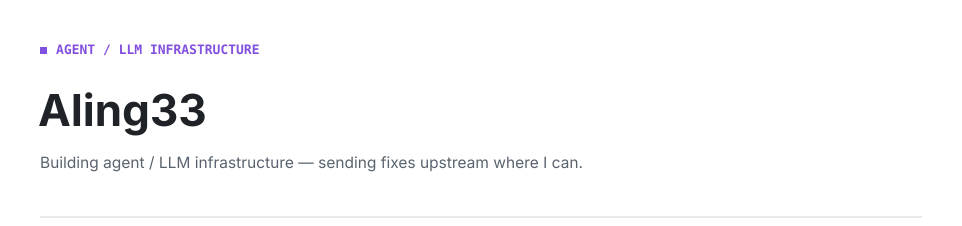
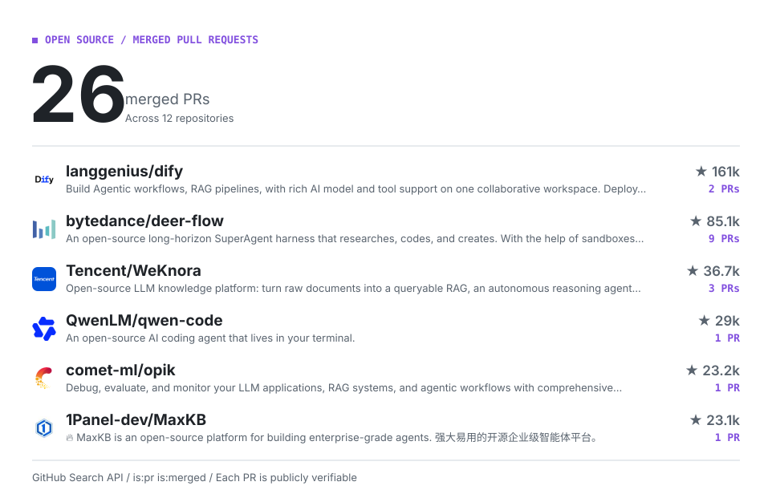

<picture>
  <source media="(prefers-color-scheme: dark)" srcset="./assets/hero-dark.svg">
  
</picture>

<!-- CONTRIB:BEGIN -->
<picture>
  <source media="(prefers-color-scheme: dark)" srcset="./assets/contrib-dark.svg">
  
</picture>

Show the other 6 repositories

- [opensandbox-group/OpenSandbox](https://github.com/opensandbox-group/OpenSandbox) · 1 PR · ★ 16.5k
- [The-PR-Agent/pr-agent](https://github.com/The-PR-Agent/pr-agent) · 1 PR · ★ 15.4k
- [Eigenwise/atomic-agents](https://github.com/Eigenwise/atomic-agents) · 1 PR · ★ 6.3k
- [qdrant/fastembed](https://github.com/qdrant/fastembed) · 1 PR · ★ 3.3k
- [ZHangZHengEric/Sage](https://github.com/ZHangZHengEric/Sage) · 2 PRs · ★ 1.2k
- [DeepGym/deepgym](https://github.com/DeepGym/deepgym) · 3 PRs · ★ 26

<!-- CONTRIB:END -->
