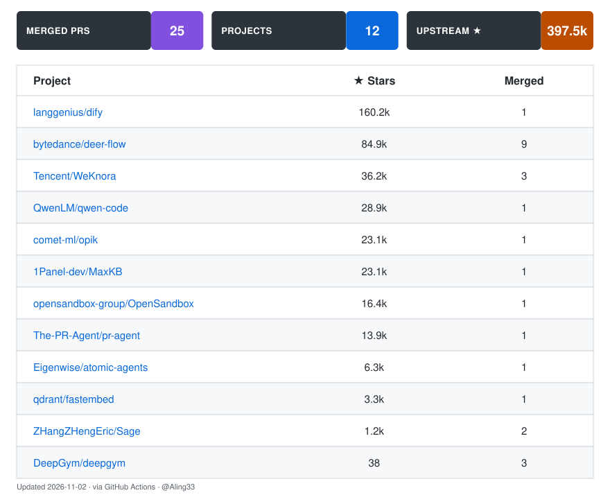

# 👋 Aling33

Building agent / LLM infrastructure — sending fixes upstream where I can.

[All Pull Requests ↗](https://github.com/pulls?q=is%3Apr+author%3A%40me) · [Repositories ↗](https://github.com/Aling33?tab=repositories) · [Full list ↗](PRS.md)

## Upstream Contributions

<!-- upstream-prs:start -->

<!-- upstream-prs:end -->

